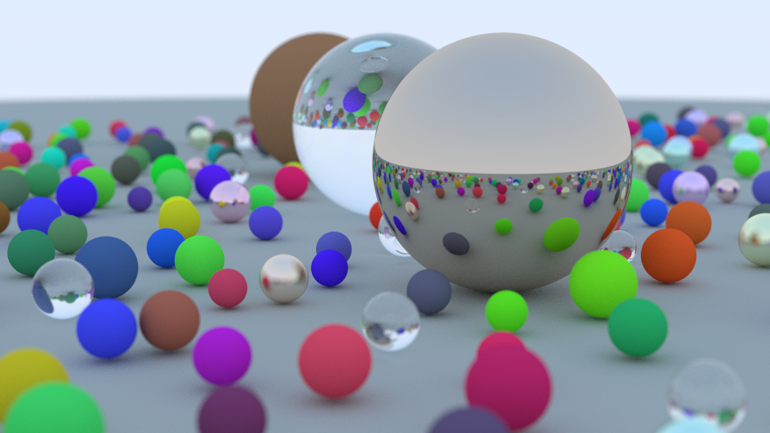
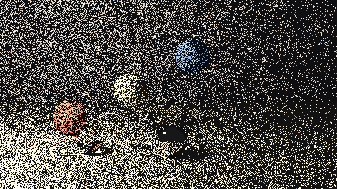

# PENUMBRA

A CPU path tracer written from scratch in Rust. No graphics libraries: the only
dependencies are `image` (PNG encoding), `rand` (random numbers) and `rayon`
(threads).

Named after the partially lit region between light and shadow, which a
physically based renderer reproduces without being told to.


*`penumbra` scene, 960x540, 1024 samples per pixel. One spherical lamp, off
frame to the upper left. The higher a sphere floats, the wider the soft edge of
its shadow.*

| | |
|---|---|
|  |  |
| `cornell`, 2048 spp | `field`, 479 spheres, 512 spp |

## Usage

```bash
cargo run --release -- --scene penumbra --width 960 --spp 1024 --clamp 8 --out penumbra.png
```

```
--scene <NAME>     penumbra, cornell, showcase or field   [default: penumbra]
--list             list scenes
--width <PX>       height follows the scene's aspect ratio [default: 800]
--spp <N>          samples per pixel                       [default: 128]
--depth <N>        maximum bounces                         [default: 50]
--seed <N>         same seed, same image                   [default: 0]
--out <PATH>       output PNG                              [default: <scene>.png]
--bvh <METHOD>     sah or midpoint                         [default: sah]
--no-direct        plain path tracing, no light sampling
--clamp <VALUE>    clamp sample radiance to remove fireflies (biased)
--threads <N>      worker threads                          [default: all cores]
```

## What it does

- Spheres and parallelograms; diffuse, metal, glass and emissive materials.
- Flat, stack-traversed BVH with midpoint or binned-SAH construction.
- Thin-lens camera with depth of field.
- Iterative path tracing with Russian roulette.
- Next event estimation: every diffuse bounce samples a light directly, by
  solid angle for spheres and by area for quads.
- Parallel over scanlines, and deterministic: the output is bit-identical for
  any thread count.
- sRGB output.

The design decisions and their reasons are in [ARCHITECTURE.md](ARCHITECTURE.md).

## Why light sampling matters here

Same scene, same 64 samples per pixel, same render time to within a factor of
two. Left: plain path tracing, which only finds the lamp when a random bounce
happens to hit it. Right: direct light sampling.

| `--no-direct` | default |
|---|---|
|  |  |

Both converge to the same image. That is not taken on trust:
`tests/direct_lighting.rs` renders one scene both ways and requires the image
means to agree within 2% per channel.

## How it is checked

78 tests (`cargo test`). The ones that carry the most weight:

- **Furnace tests.** A sphere inside a uniformly white environment must look
  exactly as bright as its albedo; a white diffuse sphere, a perfect mirror and
  clear glass must be invisible. Diffuse and mirror are exact to 1e-12.
- **BVH against brute force.** Thousands of random rays through a mixed bag of
  primitives must give the same nearest hit with and without the tree, for both
  split methods.
- **Determinism.** One thread and seven threads produce identical pixels.
  Midpoint and SAH trees produce identical pixels.
- **Light sampling.** The estimated solid angle of a sphere and of a quad match
  their closed forms.
- **No silent NaN.** Every sample is checked before it is accumulated; rejected
  samples are counted and the CLI warns if the count is not zero. It is zero in
  every scene and test here.

## Measurements

On the 10-core machine this was written on, `field` at 480x270, 32 spp:

| | time |
|---|---|
| 1 thread | 1.04 s |
| 10 threads | 0.16 s |

SAH against midpoint, single thread, same settings:

| scene | SAH | midpoint |
|---|---|---|
| `showcase`, 20 spheres | 0.63 s | 0.62 s |
| `field`, 479 spheres | 1.04 to 1.10 s | 1.08 to 1.09 s |

That is no measurable difference. These scenes are spheres of similar size
spread evenly, which is the case where splitting space in half is already close
to optimal, and a sphere test costs about the same as a box test. SAH is the
default because it is the method that keeps working when the geometry is uneven,
not because it wins here.

## Limitations

- No multiple importance sampling. Rough metals are treated as mirrors for
  light sampling, and a shading point inside a spherical light gets no direct
  light.
- Caustics are found only by chance, so they are noisy. The reference renders
  of `penumbra` and `cornell` use `--clamp 8`, which removes the resulting
  fireflies at the cost of slightly darker caustics.
- No textures, triangles, transforms or volumes.
