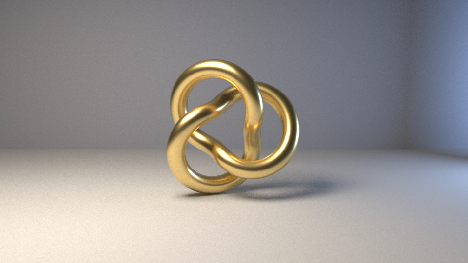
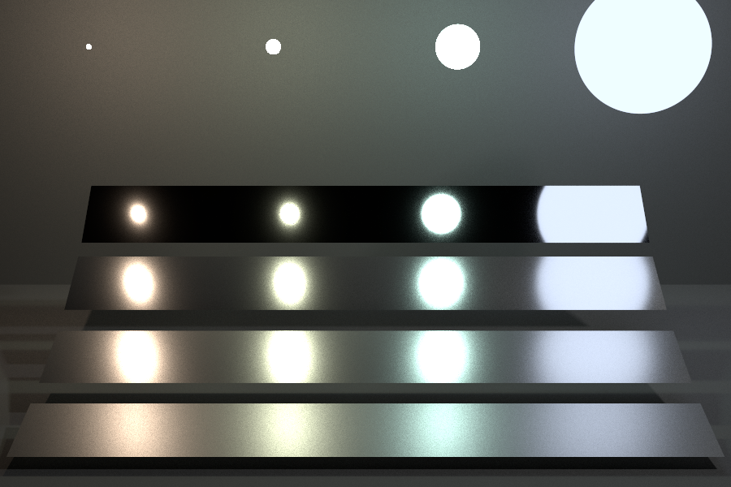
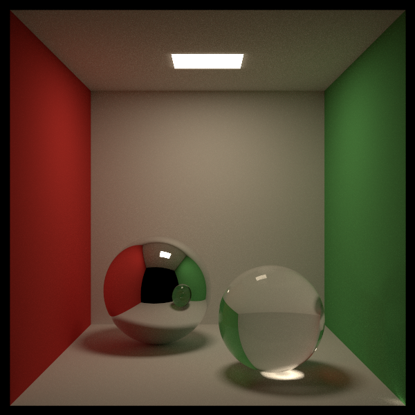
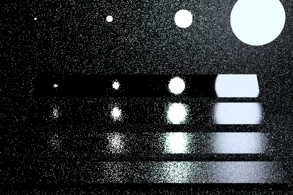
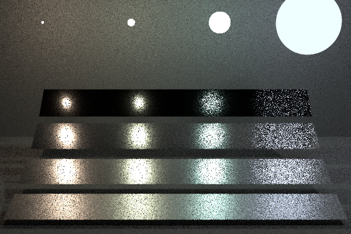
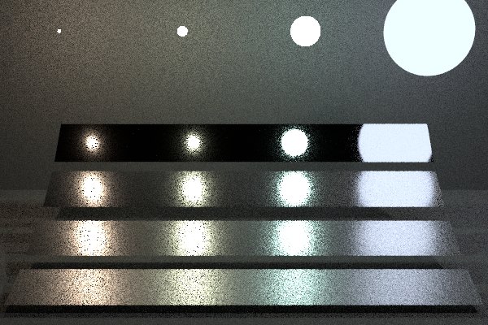
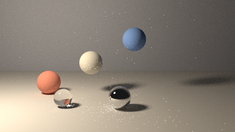

# PENUMBRA

A CPU path tracer written from scratch in Rust. No graphics libraries: the only
dependencies are `image` (PNG encoding), `rand` (random numbers) and `rayon`
(threads).

Named after the partially lit region between light and shadow, which a
physically based renderer reproduces without being told to.



*`knot` scene: 98,304 triangles generated from a formula, 960x540, 1024
samples per pixel, 55 seconds on 10 cores.*



*`plates` scene, 512 samples per pixel: the standard test for multiple
importance sampling. Smooth plate at the back, rough at the front; lights from
tiny to large.*


*`penumbra` scene, 960x540, 1024 samples per pixel. One spherical lamp, off
frame to the upper left. The higher a sphere floats, the wider the soft edge of
its shadow.*

| | |
|---|---|
|  |  |
| `cornell`, 2048 spp | `field`, 479 spheres, 512 spp |

## Usage

```bash
cargo run --release -- --scene penumbra --width 960 --spp 1024 --clamp 8 --out penumbra.png
```

Render your own model: any Wavefront OBJ file is scaled, stood on the floor
and lit in the same studio as the knot.

```bash
cargo run --release -- --obj path/to/model.obj --finish clay --turn 30
```

```
--scene <NAME>     penumbra, knot, plates, cornell, showcase or field [default: penumbra]
--list             list scenes
--obj <PATH>       render an OBJ file in a studio instead of a named scene
--finish <NAME>    surface for --obj: clay, gold or glass  [default: clay]
--turn <DEGREES>   rotate the --obj model about the vertical axis
--width <PX>       height follows the scene's aspect ratio [default: 800]
--spp <N>          samples per pixel                       [default: 128]
--depth <N>        maximum bounces                         [default: 50]
--seed <N>         same seed, same image                   [default: 0]
--out <PATH>       output PNG                              [default: <scene>.png]
--bvh <METHOD>     sah or midpoint                         [default: sah]
--lighting <MODE>  mis, light or bsdf                       [default: mis]
--clamp <VALUE>    clamp sample radiance to remove fireflies (biased)
--threads <N>      worker threads                          [default: all cores]
```

## What it does

- Spheres, parallelograms and triangle meshes; diffuse, mirror, glass,
  emissive and glossy (GGX microfacet) materials.
- A hand-written OBJ reader (no parser dependency). Meshes without normals
  are smoothed, except across edges sharper than 40 degrees, so a cube stays
  a cube.
- Triangles shade with interpolated corner normals.
- Flat, stack-traversed BVH with midpoint or binned-SAH construction.
- Thin-lens camera with depth of field.
- Iterative path tracing with Russian roulette.
- Multiple importance sampling: every rough bounce takes one sample aimed at
  a light and one from the surface's own reflection lobe, and weighs them with
  the power heuristic. Lights are sampled by solid angle for spheres and by
  area for quads and triangles, so a mesh can be a light.
- Parallel over scanlines, and deterministic: the output is bit-identical for
  any thread count.
- sRGB output.

The design decisions and their reasons are in [ARCHITECTURE.md](ARCHITECTURE.md).

## Why two sampling strategies

There are two ways to find a light from a surface: aim at the light, or follow
the surface's reflection and see what it hits. Each fails somewhere. All three
images below use 16 samples per pixel.

| follow the reflection (`--lighting bsdf`) | aim at lights (`--lighting light`) | both, weighted (`--lighting mis`) |
|---|---|---|
|  |  |  |

- **Following the reflection** finds the large light in the smooth plate and
  almost never finds the tiny one. Everything diffuse is noise.
- **Aiming at lights** fixes the diffuse surfaces and the small lights, but
  the large light in the smooth plates (right side, top two plates) turns to
  speckle: a random point on a big light rarely lies in a narrow reflection.
- **Weighting both** by how likely each was to produce the direction is clean
  in every corner, at the same cost as aiming at lights alone (0.22 s each).

All three converge to the same image. That is not taken on trust:
`tests/direct_lighting.rs` renders a scene with diffuse, glossy, mirror and
glass surfaces in each mode and requires the image means to agree within 2%
per channel.

The effect on a scene with one small lamp and no glossy surfaces, at 64
samples per pixel:

| `--lighting bsdf` | default |
|---|---|
|  |  |

## How it is checked

124 tests (`cargo test`). The ones that carry the most weight:

- **Furnace tests.** A sphere inside a uniformly white environment must look
  exactly as bright as its albedo; a white diffuse sphere, a perfect mirror and
  clear glass must be invisible. Diffuse and mirror are exact to 1e-12.
- **BVH against brute force.** Thousands of random rays through a mixed bag of
  primitives must give the same nearest hit with and without the tree, for both
  split methods.
- **Meshes against the analytic sphere.** A sphere built from 2,048 triangles
  renders to within 1% of the exact one. A white diffuse mesh in the furnace
  is invisible to within 0.2%.
- **OBJ round trip.** A mesh written to OBJ and read back is identical to the
  last bit; nine kinds of malformed input each report the right line.
- **Determinism.** One thread and seven threads produce identical pixels.
  Midpoint and SAH trees produce identical pixels.
- **Light sampling.** The estimated solid angle of a sphere, a quad and a
  triangle match their closed forms, and evaluating a light's density gives
  the value its sampler reported.
- **Glossy sampling.** The fraction of reflection samples landing in a cone
  equals the integral of the evaluated density over that cone, and no sample
  ever carries a weight above 1.
- **No silent NaN.** Every sample is checked before it is accumulated; rejected
  samples are counted and the CLI warns if the count is not zero. It is zero in
  every scene and test here.

## Measurements

On the 10-core machine this was written on, `field` at 480x270, 32 spp:

| | time |
|---|---|
| 1 thread | 1.04 s |
| 10 threads | 0.16 s |

SAH against midpoint, single thread, same settings:

| scene | SAH | midpoint |
|---|---|---|
| `showcase`, 20 spheres | 0.63 s | 0.62 s |
| `field`, 479 spheres | 1.04 to 1.10 s | 1.08 to 1.09 s |
| `knot`, 98,304 triangles (16 spp) | 0.97 to 1.01 s | 1.01 to 1.04 s |

SAH is a few percent ahead on the mesh and indistinguishable on the spheres.
All three scenes are made of evenly sized, evenly spread primitives, which is
the case where splitting space in half is already close to optimal. SAH is the
default because it is the method that keeps working when geometry is uneven; a
scanned model with mixed triangle sizes is the test these scenes cannot give.

Going from 479 primitives to 98,304 costs almost nothing per ray, which is the
point of the tree.

## Limitations

- The glossy material models single scattering only, so it darkens as
  roughness rises. In the furnace test image a white glossy sphere dims the
  image mean by 0% at roughness 0.05, 5% at 0.5 and 25% at 1.0.
- The older `metal` material with non-zero fuzz is still treated as a mirror
  for light sampling. Use `glossy` for rough reflectors.
- Lights are chosen uniformly, which wastes samples in scenes with many
  lights of very different brightness.
- Caustics are found only by chance, so they are noisy. The reference renders
  of `penumbra` and `cornell` use `--clamp 8`, which removes the resulting
  fireflies at the cost of slightly darker caustics.
- Interpolated normals are not corrected at the shadow terminator, so very
  coarse meshes show faceted shadow edges.
- OBJ materials, texture coordinates and groups are ignored: one finish per
  model.
- No textures or volumes.
